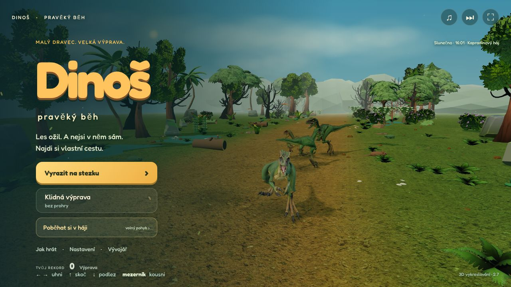
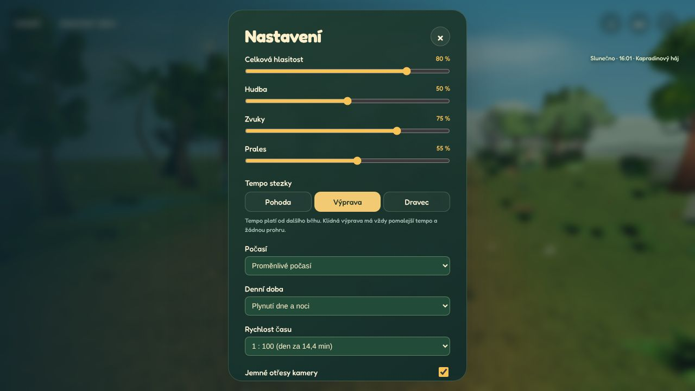
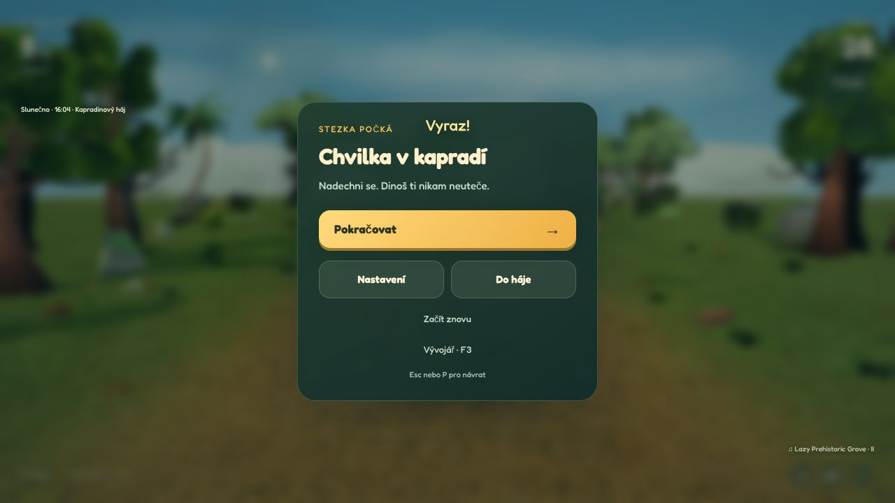
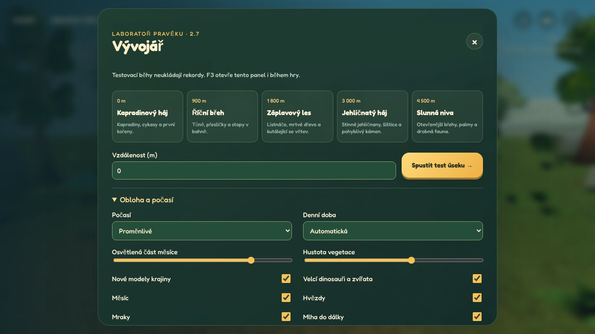
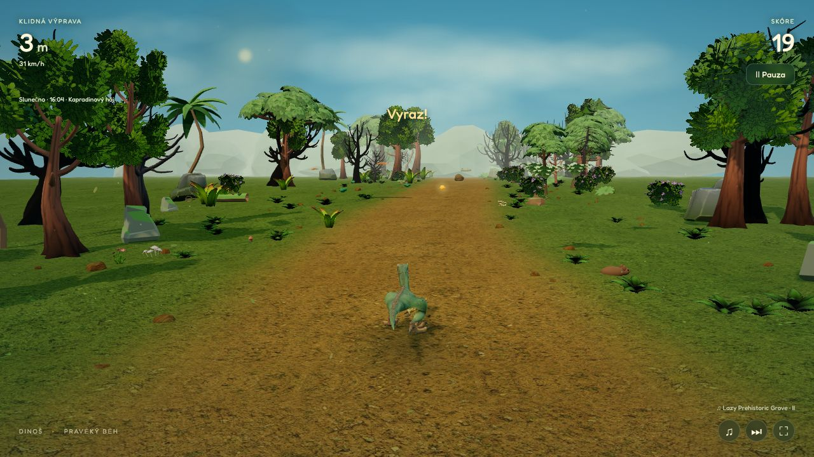
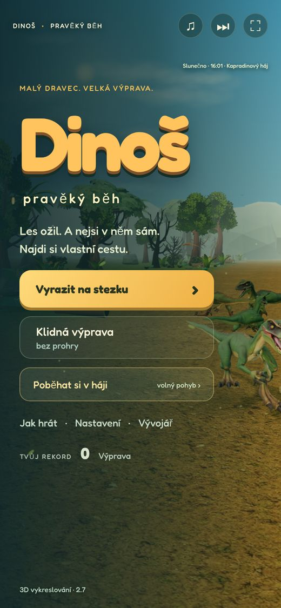

# Dinoš 2.7 – rozbor hry (reverzní inženýrství)

Zpracováno 19. 11. 2026 z archivu `Dinos_2.7` (stav z 8. 11. 2026). Rozbor nic v archivu nemění; všech 323 souborů ze `SOUBORY_SHA256.json` je v repu bajt po bajtu shodných. Hodnocení menu a nabídek je zvlášť v [SHELL_HODNOCENI.md](SHELL_HODNOCENI.md).

Značení jistoty: **[ověřeno]** = sama jsem spustila nebo změřila, **[z kódu]** = přečteno ve zdrojích, **[z dokumentů]** = tvrzení z přiložené historie, které jsem neověřovala, **[úsudek]** = můj závěr.

## 1. Co to je

Nekonečný běh ve třech pruzích („endless runner“) v prohlížeči. Malý dravec běží pravěkou krajinou, přeskakuje, podlézá, kouše a sbírá jantar. Vedle soutěžního běhu má hra klidný režim bez prohry a volné pobíhání v háji.

Celá hra je jeden soubor HTML o velikosti 63 721 172 B. Uvnitř je kód, 83 binárních souborů (modely, textury, zvuky, hudba) a 4 řezy písma. Nepotřebuje server ani internet.

## 2. Co jsem ověřila

| Zkouška | Výsledek |
|---|---|
| `npm ci` a `npm test` v čisté kopii `zdroje/` | 80 testů, 80 prošlo **[ověřeno]** |
| `npm run build` a `node tools/validate-build.mjs` | výstup má stejný otisk SHA-256 jako `Dinos_2_Stezka_oziva.html` v archivu (`5a8cb445…`), sestavení je tedy opakovatelné **[ověřeno]** |
| Kontrolní součty archivu | 323 z 323 souborů souhlasí **[ověřeno]** |
| Spuštění v prohlížeči Chrome bez grafické karty (softwarový WebGL 2) | hra naběhla ve 3D větvi (`renderer: webgl2`), menu, nastavení, nápověda, Vývojář, běh, pauza i háj fungují, bez chyb v konzoli **[ověřeno]** |
| Osobní údaje a tajné klíče ve zdrojích | nenalezeny **[ověřeno]** |

Poznámka k 3D: původní předání uvádí, že 3D větev nebyla nikdy spuštěna v prohlížeči (jen náhradní Canvas). U mě 3D větev běžela, ale na softwarovém vykreslování. Plynulost na skutečné grafické kartě tedy pořád nikdo nezměřil.

Samostatně dodaný soubor `Dinos_2_Stezka_oziva.html` (41 425 916 B) je starší verze **2.6**, ne 2.7. V repu není; verze 2.6 je zachycena v `historie/2.6/`.

## 3. Jak hra funguje

### 3.1 Jádro: `zdroje/src/core.mjs`

Třída `Runner` drží celý stav běhu a neví nic o vykreslování **[z kódu]**.

- Jednotky jsou metry a sekundy. Hráč stojí u Z = 0, svět se sune k němu ve směru +Z. Pruhy mají X = −2,35 / 0 / +2,35 m.
- Krok simulace je 1/120 s. Hlavní smyčka střádá čas, udělá nejvýš 12 kroků na snímek a zbytek zahodí, takže po přepnutí okna hra nedohání.
- Fáze: `menu → ready (odpočet 1,05 s) → playing → stumble (0,72 s) → dead`, k tomu `paused`. V klidném režimu se po zavrávorání běží dál s 1,5 s nezranitelnosti.
- Skok: počáteční rychlost 9 m/s, tíže 25 m/s². Vychází výška 1,62 m a doba letu 0,72 s. Stisk skoku se pamatuje 0,16 s.
- Podřep se drží, dokud pod kládou neprojede i ocas. Krátké gesto na telefonu drží podřep nejméně 0,48 s.
- Kousnutí trvá 0,32 s a má prodlevu 0,4 s.

Rychlost roste se vzdáleností podle zvoleného tempa:

| Tempo | Start | Strop | Stropu dosáhne po | Rozestup řad |
|---|---|---|---|---|
| Pohoda (`klid`) | 8,8 m/s | 16 m/s | 600 m | 28,8 m |
| Výprava (`lov`) | 11 m/s | 23 m/s | 632 m | 34,5 m |
| Dravec (`dravec`) | 13 m/s | 27 m/s | 560 m | 35,6 m |

Rozestup řad se počítá ze stropu rychlosti, takže čas na reakci zůstává i při nejvyšší rychlosti 1,32–1,8 s.

### 3.2 Trať a překážky

Řady se generují 100 m před hráčem ze seedovaného generátoru (mulberry32). Prvních šest řad je výuka v pevném pořadí: jantar, kámen, kláda, větev, kořist, štít. Potom se losuje:

- 22 %: trojice jantarů po 2 m,
- 7 %: štít,
- jinak překážka; od 180 m s pravděpodobností 28 % ještě druhá v jiném pruhu. Jeden pruh zůstává vždy volný.

| Prvek | Jak ho zvládnout | Od |
|---|---|---|
| Kámen | přeskočit | 0 m |
| Nízký kmen | podlézt | 0 m |
| Suchá větev | rozkousnout nebo obejít | 0 m |
| Kořist | rozkousnout | 0 m |
| Trní | obejít | 150 m |
| Kořeny | přeskočit | 450 m |
| Brod | přeskočit; jinak jen smaže kombo | 900 m |
| Kutálející se větev | přeskočit, kývá se ±0,35 m v pruhu | 1 800 m |
| Pohyblivý kámen | přeskočit | 3 000 m |
| Jantar, štít | sebrat | — |

Kolize nejsou „dotyk v daném okamžiku“, ale průnik úseček pohybu ve třech osách mezi dvěma kroky (`sweepContact`). Rychlý hráč proto nemůže překážkou proletět. Zranitelný je jen trup, ocas ne.

Body: 5 za metr, jantar 30, kořist 50, větev 60, vyhnutí 10. Odměny se násobí kombem až do ×8; kombo vyprší po 3,5 s.

### 3.3 Svět kolem

- **Úseky** (`progression.mjs`): Kapradinový háj 0 m, Říční břeh 900 m, Záplavový les 1 800 m, Jehličnatý háj 3 000 m, Slunná niva 4 500 m. Složení vegetace se prolíná na 180 m.
- **Stezka** (`environment.mjs`, funkce `route`): zatáčky a kopce jsou součtem dvou sinusovek. Stejnou funkcí se ohýbá zem, překážky i kulisy, takže kolize zůstávají v rovných pruzích a zakřivení je jen vizuální.
- **Čas a počasí**: den trvá při měřítku 1 : 100 celkem 864 s. Pět druhů počasí se střídá po 35–70 s a hodnoty (déšť, vítr, oblačnost, vedro) k cíli plynule dojíždějí.
- **Krajina** (`nature.mjs`, `nature-layout.mjs`): 43 modelů Quaternius, z nich 546 rozmístěných kusů kreslených po dávkách (`InstancedMesh`), a 11 zvířat s kosterní animací.
- **Dinosaurus** (`raptor.mjs`): model má jedinou animaci běhu. Skok, podřep, kousnutí a pád se dopočítávají otáčením kostí nad ní. Před každým snímkem se kostra vrací do čisté pózy, jinak by se otáčení sčítala.
- **Úlomky** (`physics.mjs`): fyzika Rapier se používá jen na 32 třísek po rozkousnutí. O prohře nerozhoduje.

### 3.4 Dvě vykreslování nad jedním stavem

`main.mjs` zkusí WebGL 2. Když není, nebo když 3D selže kdykoli za běhu, přepne na Canvas 2D (`canvas-scene.mjs`). Náhradní vykreslení používá stejný `Runner`, stejné vstupy a zvuk; dinosaura kreslí z atlasu 88 předem vyrenderovaných snímků původního modelu, krajinu ze dvou atlasů.

### 3.5 Zvuk a hudba

Web Audio se čtyřmi sběrnicemi (celková, hudba, zvuky, prales) a kompresorem. Hudba je osm nahrávek ze Suno. Přehrávač (`music.mjs`) drží vždy jediný hudební hlas: nejdřív doztlumí starou skladbu, pak pustí novou. Hraje úryvky 60–95 s a skladby střídá bez opakování. Skladby se dekódují až podle situace a nepotřebné se uvolňují z paměti. Vítr a déšť jsou generovaný šum.

## 4. Jak byla postavena

```
zdroje/
  index.html          všechny obrazovky jako HTML (menu, pauza, nastavení, nápověda, HUD)
  src/main.mjs        propojení: vstupy, nabídky, smyčka, volba vykreslování   26 kB
  src/core.mjs        pravidla běhu                                           10 kB
  src/world.mjs       3D svět a překážky                                      17 kB
  src/canvas-scene.mjs náhradní 2D vykreslení                                 17 kB
  src/developer.mjs   panel Vývojář                                           10 kB
  src/…               15 menších modulů (hudba, počasí, obloha, krajina…)
  tests/              8 souborů, 80 testů (node --test)
  tools/build.mjs     esbuild → jeden HTML, data vložená jako base64
  public/             model, atlasy, 43 modelů krajiny, hudba, zvuky, písma    44 MB
```

Celkem 20 modulů a 128,5 kB kódu. Knihovny: Three.js 0.180.0, Rapier 0.19.3, esbuild 0.25.0, Vite 6.1.0 jen pro vývoj.

Sestavení čte 87 souborů z `public/`, převede je na `data:` adresy a vloží do stránky jako `window.DINO_ASSETS`. Kód se k souborům dostává přes funkci `asset(cesta)`, která při vývoji vrací běžnou adresu a v hotovém souboru vložená data. Kontrolní skript po sestavení porovná otisky vložených dat se zdroji.

### Historie **[z dokumentů]**

| Verze | Datum | Velikost | Testů | Co přibylo |
|---|---|---|---|---|
| původní | — | — | — | export z Groku: React Three Fiber, kolize přes události Rapieru, serverová kostra navíc |
| 2.0 | 31. 10. | — | — | přepis do čistých modulů bez Reactu, vlastní průběžné kolize |
| 2.1 | 1. 11. | 22,6 MB | 28 | náhradní Canvas 2D, zotavení z chyb |
| 2.2 | — | — | — | oprava směru země, jeden hudební hlas, háj |
| 2.3 | — | 41,4 MB | — | hudba ze Suno |
| 2.4 | — | 41,4 MB | 53 | počasí, denní doba, zatáčky, kořeny, brody |
| 2.5 | — | 41,4 MB | 58 | krok v podřepu, střídání úryvků |
| 2.6 | — | 41,4 MB | 71 | obloha, pět úseků, pohyblivé překážky, Vývojář |
| 2.7 | 8. 11. | 63,7 MB | 80 | 43 modelů krajiny a zvířat |

Původní kód z Groku je v `puvodni_herni_zdroje/`. Přepis podle všeho dělal agent ChatGPT (soubor `AGENTS.md`, sebekritické zprávy v `historie/`) **[úsudek]**.

## 5. Silné stránky

1. **Pravidla jsou oddělená od obrazu.** `Runner` jde testovat bez prohlížeče a obě vykreslování nad ním dávají stejnou hru.
2. **Kolize odolné proti rychlosti** a férové (trup, ne ocas; podřep čeká na ocas).
3. **Odolnost při startu.** Časové limity načítání, tlačítko „Zkusit znovu“, pád 3D za běhu přepne na 2D, chyba zvuku ani fyziky hru nezastaví.
4. **Testy hlídají dřívější chyby** (kumulace rotací kostí, překryv hudby, směr textury země).
5. **Opakovatelné sestavení s kontrolou otisků.**
6. **Poctivá dokumentace**: historie obsahuje i přiznané chyby předchozích odevzdání.

## 6. Slabá místa

1. **Kód je psaný jako po minifikaci.** `main.mjs` má 119 řádků, nejdelší 1 304 znaků; 20 modulů má dohromady 658 řádků. Čte se i upravuje špatně a v rozdílech verzí není vidět, co se změnilo.
2. **`main.mjs` dělá všechno**: vstupy, nabídky, ukládání, smyčku, kameru, diagnostiku. Stav je v globálních proměnných modulu.
3. **Chybí historie v gitu.** Verze 2.0–2.6 existují jen jako zprávy; kód jednotlivých verzí v archivu není.
4. **Velikost.** 63,7 MB v jednom souboru; `raptor.glb` má 11,4 MB (podle historie 34 234 trojúhelníků a neindexovaná síť). Původní předání uvádí, že otevření souboru v jejich prohlížeči skončilo vypršením času.
5. **Výkon na skutečné grafické kartě nikdo nezměřil.**
6. **Seed běhu je čas spuštění** a nikde se neukazuje, takže běh nejde zopakovat ani sdílet.
7. Vady nabídek jsou v [SHELL_HODNOCENI.md](SHELL_HODNOCENI.md).

## 7. Původ a licence

Podrobně v `LICENCE_A_PUVOD.md`. K veřejnému repu tři poznámky:

- **Model raptora** je z Meshy. Podle dokumentace Meshy jsou modely z bezplatného tarifu pod CC BY 4.0 (stačí uvést zdroj) a modely z placených tarifů patří uživateli. Pro jistotu: *model created with Meshy*.
- **Hudba** je ze Suno z účtu autora hry.
- **Textury `ground.jpg`, `rock.jpg`, `wood.jpg`** pocházejí z exportu z Groku a samostatnou licenci nemají. Je to jediná položka s nejasným původem; dají se nahradit vlastními nebo generovanými.

Modely krajiny (Quaternius) a zvuky (Kenney) jsou CC0, písmo Fredoka má OFL.

## 8. Snímky

Pořízeno 19. 11. 2026 v Chrome se softwarovým WebGL.

| | |
|---|---|
|  |  |
|  |  |
|  |  |
